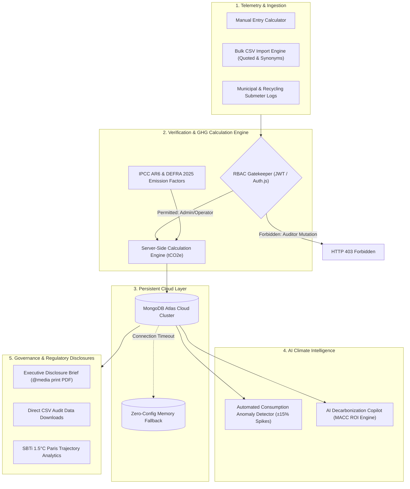

# 🌿 EcoTrack — Enterprise Carbon Intelligence & ESG Management

> **Audit-Grade GHG Protocol Scope 1, 2, & 3 Accounting, Water Circularity, Real-Time AI Decarbonization Advisory, and Role-Governed Regulatory Reporting.**

[-black?logo=next.js)](https://nextjs.org/)
[](https://react.dev/)
[](https://tailwindcss.com/)
[](https://www.mongodb.com/)
[](#regulatory-compliance)

---

## 📌 Executive Summary & Core Problem Solved

Enterprises face aggressive legal mandates to disclose verified climate metrics (**EU CSRD, US SEC Climate Rules, California SB 253, and ISO 14064-1**). However, modern organizations face a critical **operational vs. audit conflict**:

1. **Facility & Plant Operators** need low-friction ingestion tools to log daily fuel gallons, utility kWh, and water meter reads.
2. **Third-Party Auditors (e.g., Bureau Veritas, EY, PwC)** must inspect mathematical calculations ($t\text{CO}_2e = \text{Activity} \times \text{Factor}$) without allowing data tampering.
3. **Chief Sustainability Officers (CSOs)** require high-level 2030 Science-Based Targets (SBTi 1.5°C glidepaths) and signed regulatory disclosure briefs.

**EcoTrack resolves this conflict** through strict **Multi-Tenant Role-Based Access Control (RBAC)**, an immutable **server-side calculation engine**, automated **AI anomaly detection**, and **1-click audit-grade disclosure exports**.

---

## 🏛️ System Architecture



---

## 🔐 Multi-Tenant Role Permissions Matrix (RBAC)

EcoTrack features an interactive **Stakeholder Persona Switcher** in the top navigation bar, allowing reviewers to evaluate the system through three distinct organizational roles:

| Capability / Action | Corporate Admin / CSO (`admin`) | Facility Operator (`operator`) | Sustainability Auditor (`auditor`) |
| :--- | :---: | :---: | :---: |
| **Active Persona** | Michael Thomas | Elena Rostova | Dr. Eleanor Vance (Bureau Veritas) |
| **Log Single Emission Activity** | ✅ Allowed | ✅ Allowed | ❌ **Blocked (HTTP 403 / UI Lock)** |
| **Bulk CSV Batch Ingestion** | ✅ Allowed | ✅ Allowed | ❌ **Blocked (HTTP 403 / UI Lock)** |
| **Log Water Meter Reading** | ✅ Allowed | ✅ Allowed | ❌ **Blocked (HTTP 403 / UI Lock)** |
| **Set 2030 Net-Zero Targets** | ✅ Allowed | ❌ Read-Only | ❌ Read-Only |
| **Sign-off / Certify Disclosures** | ✅ Full Approval | ❌ Locked | 🔍 **Attestation Stamp Only** |
| **Inspect IPCC Factor Formulas** | ✅ Full Access | ✅ Full Access | ✅ **Full Audit Access** |
| **Export Ledgers (CSV & PDF)** | ✅ Full Access | ✅ Full Access | ✅ **Full Audit Access** |

---

## 🛡️ Route Protection & API Security

All state-mutating endpoints enforce cryptographic JWT verification and role gating:

| Endpoint | Method | Permitted Roles | Unauthorized Behavior |
| :--- | :---: | :---: | :--- |
| `/api/emissions` | `GET` | All (Public / Authenticated) | Returns verified emission ledger with auto-seeding |
| `/api/emissions` | `POST` | `admin`, `operator` | `auditor` receives `HTTP 403 Forbidden` |
| `/api/emissions/batch` | `POST` | `admin`, `operator` | `auditor` receives `HTTP 403 Forbidden` |
| `/api/water` | `POST` | `admin`, `operator` | `auditor` receives `HTTP 403 Forbidden` |
| `/api/auth/session` | `POST` | All | Switches active persona session and sets JWT cookie |
| `/api/copilot` | `GET` / `POST` | All | Scans live telemetry for spikes & generates abatement advice |

---

## 📂 Pre-Built Demonstration Datasets

Located in the [`/demo-data`](./demo-data) directory for instant live presentations:

1. **[`demo-utility-q3.csv`](./demo-data/demo-utility-q3.csv)**:
   - Contains 10 multi-sector operational entries (Manufacturing electricity, facility natural gas, steam, corporate flights, and landfill waste).
   - **How to test**: Open **Emissions $\rightarrow$ Bulk Import CSV $\rightarrow$ Drag & drop file**. Preview verified emissions before committing.
2. **[`demo-anomaly-diesel.csv`](./demo-data/demo-anomaly-diesel.csv)**:
   - Contains spiked fleet diesel consumption entries designed to demonstrate the real-time **Anomaly Alert System**.
   - **How to test**: Ingest the file or inspect the top Anomaly Banner on the dashboard.

---

## 🚀 Quickstart & Local Setup

### Prerequisites
- **Node.js** v18.x or higher (tested on Node v24)
- **npm** (or pnpm)
- *(Optional)* A running MongoDB instance or free MongoDB Atlas URI

### 1. Clone & Install
```bash
git clone https://github.com/Nandy637/eco-track.git
cd eco-track
npm install
```

### 2. Configure Environment Variables
Copy the template configuration:
```bash
cp .env.example .env.local
```

Edit `.env.local` to point to your database:
```env
# Local MongoDB:
MONGODB_URI=mongodb://localhost:27017/ecotrack

# Or MongoDB Atlas:
# MONGODB_URI=mongodb+srv://<username>:<password>@cluster0.xxxxx.mongodb.net/ecotrack?retryWrites=true&w=majority

NEXTAUTH_SECRET=ecotrack-enterprise-ghg-audit-secret-key-2026-auth
NEXTAUTH_URL=http://localhost:3000
```

> **Note on Zero-Config Fallback**: If MongoDB is not running locally, EcoTrack automatically engages its graceful memory fallback layer, ensuring all views, charts, and calculations run flawlessly without crashes.

### 3. Run Development Server
```bash
npm run dev
```
Open [http://localhost:3000](http://localhost:3000) in your browser.

### 4. Production Build
```bash
npm run build
npm run start
```

---

## ☁️ Cloud Deployment (Vercel & MongoDB Atlas)

### Step 1: Create Free MongoDB Atlas Cluster
1. Sign up at [MongoDB Atlas](https://www.mongodb.com/cloud/atlas).
2. Create a free **M0 Sandbox Cluster**.
3. Under **Database Access**, create a user (e.g. `ecotrack_admin`).
4. Under **Network Access**, add `0.0.0.0/0` (Allow Access from Anywhere for Vercel Serverless).
5. Click **Connect $\rightarrow$ Drivers $\rightarrow$ Copy connection string**:
   ```
   mongodb+srv://<username>:<password>@cluster0.xxxxx.mongodb.net/ecotrack?retryWrites=true&w=majority
   ```

### Step 2: Deploy to Vercel
1. Import repository `https://github.com/Nandy637/eco-track` in [Vercel](https://vercel.com).
2. Configure **Environment Variables**:
   * `MONGODB_URI`: Your MongoDB Atlas connection string.
   * `NEXTAUTH_SECRET`: A 32+ character random string (e.g. `ecotrack-production-secure-audit-secret-2026`).
   * `NEXTAUTH_URL`: Your Vercel deployment URL (e.g. `https://eco-track-nandy.vercel.app`).
3. Click **Deploy**. Vercel will bundle the Next.js Turbopack build and deploy edge API routes automatically.

---

## 🎬 3-Minute Live Presentation Walkthrough Script

| Time | View | What to Demonstrate & Say |
| :--- | :--- | :--- |
| **0:00 - 0:45** | **Executive Dashboard** | *"EcoTrack tracks Scope 1, 2, and 3 emissions against the 1.5°C Paris Agreement glidepath. Notice the top Anomaly Banner flagging an abnormal +3.4% diesel spike in the logistics corridor."* |
| **0:45 - 1:30** | **Emissions & Bulk Ingestion** | Click **Emissions $\rightarrow$ Bulk Import CSV**. Upload `demo-data/demo-utility-q3.csv`. *"Our parser normalizes quoted CSVs and verifies every factor server-side before atomic database insertion."* |
| **1:30 - 2:15** | **RBAC Switcher** | Click the profile dropdown in the top right $\rightarrow$ Select **Sustainability Auditor (Dr. Eleanor Vance)**. *"Notice the interface immediately shifts to Read-Only Assurance mode: mutation buttons are locked, and API requests return HTTP 403 Forbidden to prevent tampering."* |
| **2:15 - 2:45** | **AI Decarbonization Copilot** | Click **AI Copilot** in the top bar $\rightarrow$ Click *"Recommend Quick Wins"*. *"The Copilot uses Marginal Abatement Cost Curves (MACC) to recommend high-ROI projects with quantified CapEx and payback periods."* |
| **2:45 - 3:00** | **Compliance Reports** | Click **Reports**. Switch to **CSRD (ESRS E1)** $\rightarrow$ Show the **Executive Disclosure Brief** $\rightarrow$ Click **Print / Save as PDF**. Show formal CSO sign-off and auditor attestation stamp. |

---

## 📜 Compliance & Calculation Methodology
* **GHG Protocol Corporate Standard**: Scope 1 (Direct fuel), Scope 2 (Location-based electricity), Scope 3 (Indirect value chain, air travel, waste).
* **IPCC AR6**: 100-year Global Warming Potentials ($GWP_{100}$).
* **UK DEFRA 2025 & IEA 2025**: Regional electric grid factors and fuel calorific values.

---

## 📄 License
This project is open-source and available under the [MIT License](LICENSE).
