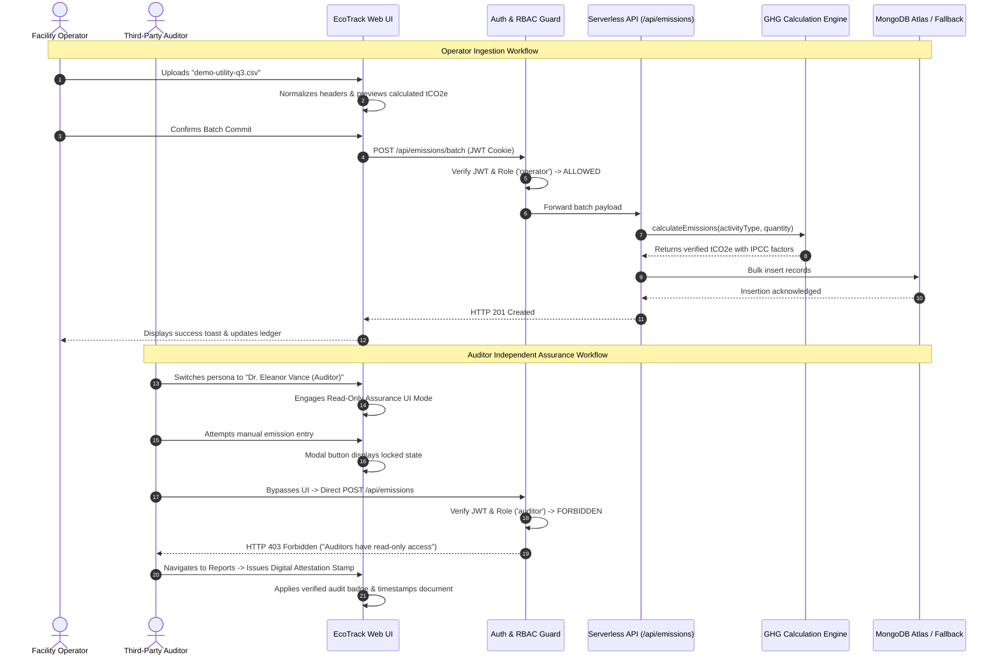
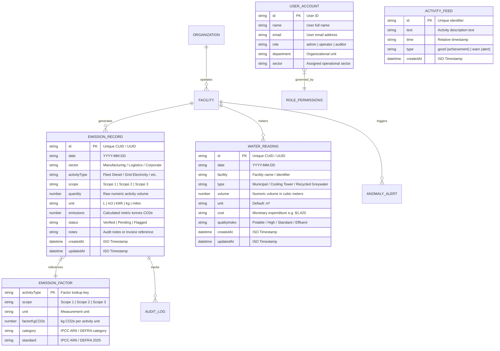

# 🌿 EcoTrack — Software Requirements & Detailed System Architecture Specification

> **Enterprise Carbon Intelligence, Water Stewardship, and ESG Regulatory Governance Platform**  
> *Compliant with GHG Protocol Corporate Standard, EU CSRD (ESRS E1), US SEC Climate Rules, California SB 253, and ISO 14064-1.*

---

## 📑 Table of Contents
1. [1. Problem Statement & Proposed Solution](#1-problem-statement--proposed-solution)
2. [2. Functional & Non-Functional Requirements](#2-functional--non-functional-requirements)
3. [3. Detailed System Architecture](#3-detailed-system-architecture)
4. [4. Actors & System Interactions](#4-actors--system-interactions)
5. [5. ER Diagram / Core Collections](#5-er-diagram--core-collections)
6. [6. Module Description](#6-module-description)
7. [7. Technology Stack](#7-technology-stack)
8. [8. Application Screens & Design Principles](#8-application-screens--design-principles)
9. [9. Frontend Development](#9-frontend-development)
10. [10. Backend Development](#10-backend-development)

---

## 1. Problem Statement & Proposed Solution

### 1.1 Problem Statement
Modern enterprises operate under unprecedented legal and financial pressure to measure, report, and reduce their greenhouse gas (GHG) footprint. Mandatory disclosure regulations—including the **EU Corporate Sustainability Due Diligence & Reporting Directives (CSRD ESRS E1)**, the **US SEC Climate Disclosure Mandates**, **California SB 253**, and **ISO 14064-1**—impose stringent compliance deadlines and civil penalties for misreporting or greenwashing.

Despite these mandates, organizations face three severe operational bottlenecks:

1. **The Ingestion & Normalization Chasm**: Facility operators, plant supervisors, and supply chain managers collect raw activity telemetry across disparate sources (utility bills in kWh, boiler fuel in cubic meters or therms, transport fleet diesel in liters, air travel miles, and water submeter logs). These records often reside in fragmented spreadsheets with inconsistent header formats and conflicting units.
2. **The Operational vs. Audit Conflict**: Operational staff need seamless, rapid interfaces to record daily emissions data. In contrast, third-party independent assurance auditors (e.g., Bureau Veritas, EY, KPMG, PwC) require strict mathematical immutability, mathematical lineage ($t\text{CO}_2e = \text{Activity} \times \text{Factor}$), factor transparency (IPCC AR6 / DEFRA 2025), and tamper-evident access controls that prevent data corruption.
3. **The Executive & Strategy Disconnect**: Chief Sustainability Officers (CSOs) and board executives often receive high-level retrospective reports months after the reporting period ends. They lack real-time visibility into consumption anomalies (such as sudden logistics fuel surges) and lack actionable, cost-quantified decarbonization roadmaps (Marginal Abatement Cost Curves with project CapEx, OpEx, and ROI).

### 1.2 Proposed Solution: EcoTrack
**EcoTrack** is a unified, audit-grade carbon intelligence and ESG resource stewardship platform engineered to bridge operational data entry, mathematical verification, independent auditing, and executive decarbonization planning into a cohesive ecosystem.

Key capabilities include:
- **Server-Side Verified GHG Calculation Engine**: Standardized emission calculations using verified IPCC AR6 $GWP_{100}$ and UK DEFRA 2025 emission factors across Scope 1 (Direct Fuel), Scope 2 (Location-Based Purchased Electricity), and Scope 3 (Value Chain, Waste, and Municipal Water).
- **Multi-Tenant Role-Based Access Control (RBAC)**: Cryptographically secured JSON Web Token (JWT) identity governance distinguishing Corporate Admins/CSOs, Facility Operators, and Third-Party Auditors with hardware-like interface enforcement (Read-Only Assurance Mode and HTTP 403 API protection).
- **Resilient Multi-Tier Ingestion**: Real-time interactive calculation modals paired with a high-throughput Bulk CSV Ingestion Engine capable of parsing quoted CSVs, whitespace-padded inputs, and header synonyms.
- **AI Decarbonization Copilot & Anomaly Detection**: Statistical telemetry scanners detecting consumption surges ($\ge 15\%$ spikes) with estimated financial penalties, complemented by an interactive AI Copilot delivering CapEx-quantified Marginal Abatement Cost Curve (MACC) recommendations.
- **Water Circularity & Resource Accounting**: Dedicated submeter telemetry tracking freshwater intake, cooling tower consumption, recycled greywater ratios, and effluent quality indices.
- **1-Click Audit & Regulatory Disclosures**: Executive disclosure briefs with clean `@media print` styling for CSRD, SEC, and GHG Protocol formats, equipped with formal CSO sign-off and auditor attestation stamps.

---

## 2. Functional & Non-Functional Requirements

### 2.1 Functional Requirements (FR)

| Req ID | Module / Area | Functional Requirement Description |
| :--- | :--- | :--- |
| **FR-01** | **Emission Ingestion** | The system must allow authorized users (Admin, Operator) to record individual emissions entries with automatic server-side computation of metric tonnes $CO_2e$ ($t\text{CO}_2e$) from raw activity quantities and units. |
| **FR-02** | **Bulk CSV Processing** | The system must provide a CSV batch import engine supporting RFC 4180 quotes, synonym field mapping (`sector`/`facility`, `activity`/`type`, `quantity`/`amount`, `unit`/`units`), and pre-commit verification previews. |
| **FR-03** | **Water Stewardship** | The system must record water meter entries categorized by intake type (Municipal, Groundwater, Recycled Greywater), compute recycling efficiency percentages, and track water quality index tiers. |
| **FR-04** | **RBAC & Governance** | The system must support dynamic role switching between **Corporate Admin/CSO**, **Facility Operator**, and **Sustainability Auditor**. Mutation actions (POST, PUT, DELETE) must be blocked both in the UI and at the API level (HTTP 403) for Auditor sessions. |
| **FR-05** | **Factor Transparency** | The system must expose the emission factor database (IPCC AR6 / DEFRA 2025) and mathematical formulas to all roles for audit traceability. |
| **FR-06** | **Anomaly Detection** | The system must automatically scan live sector telemetry and transaction ledgers to flag consumption spikes deviating $>15\%$ from baseline, displaying excess carbon and financial cost estimates. |
| **FR-07** | **Decarbonization Copilot** | The system must provide an interactive conversational AI Copilot offering MACC-ranked decarbonization interventions with estimated CapEx, annual $t\text{CO}_2e$ savings, and payback horizons. |
| **FR-08** | **Regulatory Disclosures** | The system must generate formatted disclosure reports compliant with CSRD (ESRS E1), US SEC Climate Rules, and the GHG Protocol Corporate Standard, complete with one-click print/PDF layout. |
| **FR-09** | **Data Export** | The system must provide client-side CSV downloads of the verified emissions ledger, water logs, and sector breakdowns for external spreadsheet auditing. |

### 2.2 Non-Functional Requirements (NFR)

| Req ID | Category | Metric / Specification |
| :--- | :--- | :--- |
| **NFR-01** | **Auditability & Integrity** | All calculations must execute server-side using immutable factor libraries. Raw entries must retain original timestamps, activity types, units, and verification statuses. |
| **NFR-02** | **Security & Auth** | API requests mutating system state must validate cryptographic JWTs signed with HMAC-SHA256 (`HS256`). Cookie-based session delivery with proper same-site flags. |
| **NFR-03** | **Latency & Performance** | Dashboard aggregations, ledger queries, and CSV parsing batches up to 500 records must render in $\le 200\text{ms}$. Fast Refresh & Turbopack build optimization. |
| **NFR-04** | **Reliability & Fallback** | The persistence layer must implement zero-config graceful memory failover: if MongoDB Atlas is unreachable or unconfigured, the application must operate without crashes. |
| **NFR-05** | **Responsive & Print Design** | Mobile-first responsive layouts down to 360px viewport width, collapsing sidebars, and dedicated `@media print` stylesheets hiding navigation bars during PDF generation. |
| **NFR-06** | **Usability (UX/UI)** | Adhere to modern enterprise design principles: slate/emerald color tokens, Lucide icons, glassmorphism cards, clear badge tones, and WCAG 2.1 AA compliant contrast. |

---

## 3. Detailed System Architecture

EcoTrack utilizes a **Modern Multi-Tier Serverless Jamstack Architecture** built on Next.js 16 (App Router with Turbopack), React 19, and Mongoose ODM running on Node.js runtime environments.

### 3.1 Architectural Diagram

```mermaid
flowchart TB
    subgraph CLIENT_TIER["🖥️ Presentation Layer (Client Browser - React 19 / Tailwind CSS v4)"]
        UI_Nav["Global Header & Persona Switcher (RBAC Context)"]
        UI_Dash["Executive Dashboard (Recharts / Stat Cards)"]
        UI_Ledger["Emissions & Water Ledger Tables"]
        UI_Modals["Manual Calculators & Bulk CSV Ingestion Modals"]
        UI_Copilot["AI Decarbonization Copilot Drawer"]
        UI_Reports["Regulatory Disclosures (@media print PDF)"]
    end

    subgraph AUTH_GATE["🛡️ Edge & Security Gatekeeper"]
        JWTMiddleware["JWT Session Validator (jose / NextAuth)"]
        RoleFilter{"Role Check: Admin / Operator / Auditor"}
    end

    subgraph API_TIER["⚙️ Application & Serverless API Layer (Next.js App Router)"]
        API_Auth["/api/auth/session (Session Switcher & Token Issuer)"]
        API_Emissions["/api/emissions (GET Ledger / POST Single)"]
        API_Batch["/api/emissions/batch (POST Bulk CSV Entries)"]
        API_Water["/api/water (GET / POST Water Readings)"]
        API_Stats["/api/dashboard/stats (Aggregation Pipelines)"]
        API_Copilot["/api/copilot (Anomaly Engine & MACC Abatement)"]
    end

    subgraph LOGIC_TIER["🧠 Core Logic & Domain Services"]
        GHG_Engine["GHG Factor Calculator Engine (lib/emissions.js)"]
        CSV_Engine["RFC 4180 CSV Normalizer & Parser (lib/csvParser.js)"]
        Anomaly_Service["Anomaly Detection Scanner (lib/copilotEngine.js)"]
        MACC_Service["Marginal Abatement Cost Advisory (lib/copilotEngine.js)"]
        Factor_DB[("IPCC AR6 & UK DEFRA 2025 Factors")]
    end

    subgraph DATA_TIER["💾 Persistence & State Management Layer"]
        MongoPool[("MongoDB Atlas Cloud Database (Mongoose Models)")]
        MemStore[("Zero-Config In-Memory Fallback Cache")]
        DB_Switch{"Connection Available?"}
    end

    %% Wiring
    CLIENT_TIER -->|Mutating Requests| AUTH_GATE
    CLIENT_TIER -->|Read Queries| API_TIER

    AUTH_GATE --> RoleFilter
    RoleFilter -->|Authorized: Admin / Operator| API_TIER
    RoleFilter -->|Unauthorized: Auditor Mutation| Block403["HTTP 403 Forbidden Response"]

    API_Emissions --> GHG_Engine
    API_Batch --> CSV_Engine
    CSV_Engine --> GHG_Engine
    GHG_Engine --> Factor_DB
    API_Copilot --> Anomaly_Service
    API_Copilot --> MACC_Service

    API_TIER --> DB_Switch
    DB_Switch -->|Yes (URI Valid)| MongoPool
    DB_Switch -->|No / Timeout| MemStore

    Anomaly_Service -.->|Scans Telemetry| DB_Switch
```

### 3.2 Data Flow Walkthrough
1. **Data Ingestion**: A Facility Operator submits an activity entry (e.g., $12,500\text{ kWh}$ of Grid Electricity) either via the single entry modal or through CSV drag-and-drop.
2. **Cryptographic Validation**: The request passes through `lib/auth.js`. The JWT cookie is inspected. If the user holds the `auditor` role, the server aborts with `HTTP 403 Forbidden`.
3. **Calculation & Verification**: The server calculates emissions using `lib/emissions.js`:
   $$\text{Emissions } (t\text{CO}_2e) = \frac{\text{Quantity} \times \text{FactorKgCO}_2e}{1000}$$
   For $12,500\text{ kWh} \times 0.43\text{ kgCO}_2e/\text{kWh} = 5,375\text{ kg} = 5.38\text{ tCO}_2e$.
4. **Persistence with Fallback**: The entry is dispatched to Mongoose (`models/Emission.js`). If MongoDB Atlas is connected, it is persisted to the database; otherwise, it is saved into the in-memory array fallback.
5. **Real-time Synthesis**: The anomaly detection engine checks if the new volume creates a statistical spike ($\ge 15\%$ above sector baseline). The Anomaly Banner updates dynamically across the client dashboard.

---

## 4. Actors & System Interactions

### 4.1 System Actors

| Actor | Persona Profile | Primary Objectives | System Privileges |
| :--- | :--- | :--- | :--- |
| **Corporate Admin / CSO** | **Michael Thomas** (*Corporate Global Sustainability*) | Set science-based net-zero goals, oversee organizational ESG compliance, sign off on regulatory disclosures, evaluate capital allocation. | Full administrative read/write access across all modules, target configurations, and team governance. |
| **Facility Operations Lead** | **Elena Rostova** (*Site Operations & Energy Management*) | Log daily/weekly utility usage, fuel receipts, wastewater discharge, and review plant-level efficiency. | Read and write access to emissions, bulk CSV imports, and water submeter logs; read-only access to corporate targets. |
| **Sustainability Auditor** | **Dr. Eleanor Vance** (*Bureau Veritas Assurance*) | Verify mathematical calculation lineage, review factor sources, inspect ledger entries, issue attestation statements. | Strict read-only assurance mode across all views; mutative operations blocked by UI disablement and HTTP 403 API guards. |
| **AI System Agent** | **EcoTrack Copilot** (*Automated Intelligence Service*) | Continuous background telemetry monitoring, spike detection, predictive forecasting, and abatement ROI ranking. | Automated read access to consumption data, generation of advisory recommendations. |

### 4.2 Sequence Diagram: Ingestion, Audit Assurance & Verification



---

## 5. ER Diagram / Core Collections

EcoTrack utilizes flexible, high-performance MongoDB document collections managed via Mongoose schemas.

### 5.1 Entity-Relationship Diagram



### 5.2 Core Collection Schemas & Data Dictionaries

#### 1. `Emission` Collection ([models/Emission.js](file:///c:/Users/nandh/eco-track/models/Emission.js))
Stores verified GHG accounting line items.
- `id` *(String, Indexed, Required)*: Unique business key (e.g., `em-1718293041234`).
- `date` *(String, Required)*: Date of emission occurrence in ISO format (`YYYY-MM-DD`).
- `sector` *(String, Required)*: Organizational operating boundary (e.g., `Logistics & Fleet`, `Manufacturing Site A`).
- `activityType` *(String, Required)*: Standardized fuel or energy carrier name.
- `scope` *(String, Enum: `['Scope 1', 'Scope 2', 'Scope 3']`)*: GHG Protocol classification.
- `quantity` *(Number, Required)*: Raw activity volume.
- `unit` *(String, Required)*: Physical unit of measurement (`L`, `m³`, `kWh`, `kg`).
- `emissions` *(Number, Required)*: Mathematical result in metric tonnes of $CO_2e$ ($t\text{CO}_2e$).
- `status` *(String, Default: `'Verified'`)*: Quality assurance state (`Verified`, `Audited`, `Pending`).
- `notes` *(String, Optional)*: Descriptive contextual note or utility invoice number.
- `timestamps`: Automatic Mongoose `createdAt` and `updatedAt`.

#### 2. `WaterReading` Collection ([models/WaterReading.js](file:///c:/Users/nandh/eco-track/models/WaterReading.js))
Stores hydrologic telemetry for water stewardship accounting.
- `id` *(String, Indexed, Required)*: Unique reading key.
- `date` *(String, Required)*: Reading date.
- `facility` *(String, Required)*: Target plant or administrative site.
- `type` *(String, Required)*: Submeter category (`Municipal Supply`, `Recycled Greywater`, `Cooling Tower`).
- `volume` *(Number, Required)*: Consumption/recycling volume in cubic meters ($m^3$).
- `unit` *(String, Default: `'m³'`)*: Metric measurement unit.
- `cost` *(String, Default: `'$0'`)*: Operational utility expense.
- `qualityIndex` *(String, Default: `'Standard'`)*: Water quality grade (`Potable`, `High Grade Process`, `Discharge Effluent`).

#### 3. `Activity` Collection ([models/Activity.js](file:///c:/Users/nandh/eco-track/models/Activity.js))
Powers real-time organizational audit trails and notifications.
- `id` *(String, Indexed, Required)*: Activity record identifier.
- `text` *(String, Required)*: Human-readable log entry (e.g., *"Uploaded batch utility readings for Q3"*).
- `time` *(String, Default: `'Just now'`)*: Display timestamp.
- `type` *(String, Enum: `['good', 'warn']`)*: Visual indicator tone.

---

## 6. Module Description

EcoTrack is organized into seven modular domain engines:

```
c:\Users\nandh\eco-track\
├── app/
│   ├── api/
│   │   ├── auth/session/route.js        --> Module 4: Authentication & Session Gating
│   │   ├── copilot/route.js            --> Module 5 & 6: Anomaly Detection & AI Copilot
│   │   ├── dashboard/stats/route.js    --> Module 1 & 2: Aggregated ESG KPIs
│   │   ├── emissions/route.js          --> Module 1 & 2: Emission Ledger & Verification
│   │   ├── emissions/batch/route.js    --> Module 1: Bulk CSV Ingestion Engine
│   │   └── water/route.js              --> Module 3: Water Stewardship Engine
│   ├── layout.jsx                      --> Root Layout with Hydration Guards
│   └── page.jsx                        --> Master Orchestrator View
├── components/
│   ├── analytics/                      --> Module 2: SBTi 1.5°C Analytics & Forecasting
│   ├── auth/                           --> Module 4: Persona Switcher UI
│   ├── copilot/                        --> Module 5 & 6: Copilot Drawer & Anomaly Banner
│   ├── dashboard/                      --> Module 1: Executive KPI Widgets & Sector Breakdown
│   ├── emissions/                      --> Module 1: Ledger, Single Calculator & CSV Modals
│   ├── layout/                         --> Navigation, Header & Sidebar
│   ├── reports/                        --> Module 7: CSRD / SEC Regulatory Briefs
│   └── water/                          --> Module 3: Water Submetering & Circularity
└── lib/
    ├── auth.js                         --> JWT Cryptography & Role Permission Matrix
    ├── copilotEngine.js                --> Anomaly Logic & MACC Abatement Algorithms
    ├── csvParser.js                    --> RFC 4180 Quoted CSV Parser & Synonym Matcher
    ├── emissions.js                    --> IPCC AR6 / DEFRA 2025 Emission Factor Lib
    └── mongodb.js                      --> Resilient Database Connection Pool
```

### Module 1: Ingestion & Telemetry Processing
- **Single Ingestion Modal**: Provides a dynamic calculator where users select an activity type, enter quantity, and immediately preview the verified $t\text{CO}_2e$ calculation with the underlying emission factor.
- **Bulk CSV Batch Ingestion Engine (`lib/csvParser.js`)**: Parses structured and unstructured CSVs. Implements custom regex tokenizers handling RFC 4180 quoted strings, commas within values, and whitespace trimming. Uses an alias dictionary to match synonym headers:
  - `sector` $\leftarrow$ `["sector", "facility", "location", "site", "plant"]`
  - `activityType` $\leftarrow$ `["activitytype", "activity", "type", "fuel", "source"]`
  - `quantity` $\leftarrow$ `["quantity", "amount", "volume", "consumption", "kwh", "liters"]`
  - `unit` $\leftarrow$ `["unit", "units", "uom", "metric"]`

### Module 2: GHG Protocol Verification & Calculation Engine
- Implemented in `lib/emissions.js`. Maintains verified emission factors from authoritative standards:
  - **Fleet Diesel**: $2.68\text{ kgCO}_2e/\text{L}$ (Scope 1, Direct Fuel Combustion)
  - **Natural Gas**: $2.03\text{ kgCO}_2e/\text{m}^3$ (Scope 1, Stationary Combustion)
  - **Grid Electricity**: $0.43\text{ kgCO}_2e/\text{kWh}$ (Scope 2, Purchased Electricity)
  - **Municipal Water**: $0.344\text{ kgCO}_2e/\text{m}^3$ (Scope 3, Water Supply & Treatment)
  - **Landfill Waste**: $0.52\text{ kgCO}_2e/\text{kg}$ (Scope 3, Waste Disposal)
- Enforces consistent rounding to two decimal places and guarantees that calculated carbon values are generated server-side.

### Module 3: Water Stewardship & Circularity Module
- Tracks industrial water consumption, treatment, and recycling.
- Computes recycling efficiency rates:
  $$\text{Circularity Ratio} = \left(\frac{\text{Recycled Volume}}{\text{Total Intake Volume}}\right) \times 100$$
- Monitors discharge quality indices to guarantee compliance with regional water basin discharge regulations.

### Module 4: Multi-Tenant RBAC & Identity Governance
- Implemented in `lib/auth.js` and `context/AuthContext.jsx`.
- Uses lightweight, edge-compatible JSON Web Token signing (`jose` library) with `HS256`.
- Defines three personas:
  - `admin`: Michael Thomas (Corporate Admin / CSO) — Full read/write and target management.
  - `operator`: Elena Rostova (Facility Lead) — Emission and water logging.
  - `auditor`: Dr. Eleanor Vance (Bureau Veritas) — Read-only assurance mode.
- Injects `x-user-role` and claims into requests; blocks mutative routes with HTTP 403 when invoked by auditors.

### Module 5: AI Telemetry Anomaly Detection
- Implemented in `lib/copilotEngine.js`.
- Evaluates period-over-period consumption variance across operational sectors.
- Triggers **Critical** severity alerts if sector emissions increase positive-period variance, deviating from the corporate $-4.2\%/\text{year}$ SBTi glidepath.
- Detects single-activity batch surges (e.g., diesel orders $>4,000\text{ L}$ or gas $>10,000\text{ m}^3$) exceeding 30-day facility baselines by $>15\%$.
- Generates financial penalty estimates based on average corporate carbon offset pricing ($\$25-\$50/\text{tCO}_2e$).

### Module 6: Decarbonization Copilot & Abatement Planner
- Embeds Marginal Abatement Cost Curve (MACC) domain logic.
- Analyzes organization emissions and ranks decarbonization interventions by Return on Investment (ROI):
  1. *Virtual Power Purchase Agreements (VPPA) & On-Site Solar PV*: Abates Scope 2 emissions; 3.2-year payback.
  2. *Fleet Electrification & Route Optimization*: Reduces Scope 1 diesel emissions; 4.1-year payback.
  3. *Waste Heat Recovery in Boilers*: Reduces Scope 1 gas consumption; 2.5-year payback.
  4. *Closed-Loop Wastewater Recycling*: Reduces Scope 3 water treatment footprint; 1.8-year payback.
- Answers natural language inquiries regarding CSRD ESRS E1 disclosures, SBTi targets, and carbon accounting methodology.

### Module 7: Compliance & Executive Disclosure Center
- Aggregates multi-year GHG inventory data into standardized audit formats:
  - **EU CSRD (ESRS E1 Climate Change)**
  - **GHG Protocol Corporate Accounting Standard**
  - **US SEC Climate Disclosure Regulation S-K**
- Features a printable **Executive Disclosure Brief** equipped with:
  - Official sign-off blocks for the Chief Sustainability Officer.
  - Independent third-party assurance statements for Bureau Veritas / KPMG / EY auditors.
  - Automatic print optimization (`@media print`) that strips navigation sidebars, headers, and backgrounds to produce audit-ready PDF documents.

---

## 7. Technology Stack

| Layer | Technology | Version | Purpose / Rationale |
| :--- | :--- | :--- | :--- |
| **Frontend Framework** | **Next.js (App Router)** | `16.3.3` | High-performance React framework with Turbopack for sub-second development compilation and serverless edge optimization. |
| **UI Library** | **React** | `19.0.0` | Latest React engine supporting modern server actions, optimized client components, and hooks. |
| **Styling & Design** | **Tailwind CSS** | `v4.0.0` | Utility-first styling engine with native CSS custom properties, responsive breakpoints, and `@media print` rules. |
| **Iconography** | **Lucide React** | `^1.16.0` | Comprehensive enterprise SVG icon set for climate metrics, navigation, and audit statuses. |
| **Data Visualization** | **Recharts & Custom SVG** | `^2.15.4` | Responsive SVG rendering for monthly emissions, energy source distributions, and SBTi glidepath trajectories. |
| **Database & ODM** | **MongoDB & Mongoose** | `^8.10.0` | Scalable NoSQL document store with structured schema validation, index enforcement, and connection pooling. |
| **Authentication & JWT**| **Jose** | `^6.0.8` | Universal JavaScript Cryptography library for edge-compatible JSON Web Token signing and verification (`HS256`). |
| **Analytics & Telemetry**| **@vercel/analytics** | `^1.5.0` | Real-time performance monitoring and web vital tracking. |
| **Runtime & Tooling** | **Node.js** | `>=18.x` | Serverless runtime environment with ES Modules and native Fetch API. |

---

## 8. Application Screens & Design Principles

### 8.1 Enterprise Design Principles
- **Executive Clarity & Low Cognitive Load**: Employs an intentional corporate palette anchored around slate neutral tones (`#F7F9F8` page background, `slate-800` text) paired with emerald accents (`emerald-600`) symbolizing ecological leadership.
- **Scope Distinction System**: Uses standardized badges across the interface to prevent confusion:
  - <span style="background-color: #FEF3C7; color: #92400E; padding: 2px 6px; border-radius: 4px; font-weight: 600;">Scope 1</span>: Amber/Orange tone (Direct Fuel Combustion).
  - <span style="background-color: #E0E7FF; color: #3730A3; padding: 2px 6px; border-radius: 4px; font-weight: 600;">Scope 2</span>: Indigo/Blue tone (Purchased Electricity).
  - <span style="background-color: #ECFDF5; color: #065F46; padding: 2px 6px; border-radius: 4px; font-weight: 600;">Scope 3</span>: Emerald/Teal tone (Value Chain, Waste, Water).
- **Auditor Read-Only Assurance Mode**: When the Auditor persona is active, the interface visually reflects an immutable assurance session:
  - An Amber badge displays in the header: *"Auditor Assurance Mode (Read-Only)"*.
  - Action buttons (*"Add Entry"*, *"Import CSV"*, *"Log Submeter"*) are disabled or hidden.
  - Table action menus are locked.
- **Glassmorphic Depth**: Subtle 1px borders (`border-slate-200/80`), rounded container geometry (`rounded-xl`), and micro-shadows deliver a modern, enterprise-grade finish without visual noise.

### 8.2 Application Screens Description

```
+-----------------------------------------------------------------------------------------------+
|  🌿 EcoTrack   [Search...]   [Persona: Dr. Eleanor Vance (Auditor) ▼]   [AI Copilot (2) ⚡]    |
+--------------+--------------------------------------------------------------------------------+
|  NAVIGATION  |  🚨 ALERT: Logistics diesel consumption surged +3.4% above baseline (Investigate)
|  - Dashboard |--------------------------------------------------------------------------------+
|  - Emissions |  [ Total Carbon: 1,248.6 tCO2e ]  [ Scope 1: 412 t ]  [ Scope 2: 620 t ] ...    |
|  - Water     |--------------------------------------------------------------------------------+
|  - Analytics |  [ Monthly Emission Glidepath (Paris 1.5°C) ]  |  [ Energy Source Mix ]        |
|  - Reports   |  - Historical trajectory vs. 2030 target      |  - Solar 38%, Grid 42%, Gas 20%|
|  - Settings  |--------------------------------------------------------------------------------+
|              |  Operational Sector Breakdown: Manufacturing, Logistics, Corporate Facility   |
+--------------+--------------------------------------------------------------------------------+
```

1. **Executive Dashboard (`DashboardView.jsx`)**:
   - High-level KPI stat cards: Net Total Emissions ($t\text{CO}_2e$), Scope 1/2/3 splits, Year-over-Year change, and Active SBTi Progress.
   - Monthly emissions line chart tracking actuals against the 1.5°C Paris Agreement reduction glidepath.
   - Energy source breakdown donut chart (Grid, Solar PV, Natural Gas).
   - Sector performance matrix with inline anomaly flags and real-time audit activity feed.
2. **Emissions Inventory & Verification Ledger (`EmissionsView.jsx`)**:
   - Comprehensive data table of all recorded GHG activities.
   - Filtering by Scope, Sector, and Date Range.
   - Modal calculators for manual data entry with live formula factor feedback.
   - Drag-and-drop CSV batch import modal with multi-row validation preview.
   - Direct CSV export button for offline spreadsheet verification.
3. **Water Stewardship & Resource Circularity View (`WaterView.jsx`)**:
   - Total freshwater withdrawal vs. recycled greywater volume metrics.
   - Closed-loop circularity percentage gauge.
   - Facility submeter log with water quality tiers (`Potable`, `High Grade`, `Standard`).
   - Modal to log new water meter readings.
4. **1.5°C Paris Trajectory & Predictive Analytics (`AnalyticsView.jsx`)**:
   - Advanced decarbonization modeling comparing business-as-usual (BAU) projections with the corporate Science-Based Targets initiative (SBTi) 2030 glidepath.
   - Scope 1, 2, and 3 intensity ratios per million dollars of revenue.
5. **Regulatory Disclosures & Executive Briefs (`ReportsView.jsx`)**:
   - Tabbed framework selector: CSRD (ESRS E1), US SEC Regulation S-K, GHG Protocol Standard.
   - Printable Executive Disclosure Brief with official CSO signature block and Auditor attestation stamp.
   - Instant `@media print` PDF generation.
6. **AI Decarbonization Copilot Drawer (`CopilotDrawer.jsx`)**:
   - Slide-out intelligence assistant with quick action buttons (*"Recommend Quick Wins"*, *"Analyze Scope 2"*, *"Review Anomalies"*).
   - Marginal Abatement Cost Curve project cards showing estimated CapEx, annual emissions savings, and payback period.
7. **Anomaly Alert Banner (`AnomalyAlertsBanner.jsx`)**:
   - Top-level persistent alert drawer alerting users to active consumption surges.
   - Displays estimated financial impact and a 1-click action button to inspect the flagged ledger entry.

---

## 9. Frontend Development

### 9.1 Component Hierarchy & Structure
The frontend is constructed using modular, reusable components adhering to atomic design principles:

```
app/page.jsx (Client Root Orchestrator)
│
├── context/AuthContext.jsx (RBAC State, JWT Cookie, Current User Persona)
│
├── components/layout/Sidebar.jsx (Responsive Navigation Drawer)
├── components/layout/Header.jsx (Breadcrumb, Search, Anomaly Badge, PersonaSwitcher)
│
├── components/copilot/AnomalyAlertsBanner.jsx (Global Anomaly Notification)
├── components/copilot/CopilotDrawer.jsx (Slide-out AI Abatement Interface)
│
├── [VIEW 1] components/dashboard/DashboardView.jsx
│   ├── components/dashboard/StatCard.jsx (KPI Metric Cards)
│   ├── components/dashboard/EnergyUsage.jsx (Recharts Trajectory Chart)
│   ├── components/dashboard/EnergySources.jsx (Donut Source Mix)
│   ├── components/dashboard/GoalsCard.jsx (SBTi Glidepath Target Tracker)
│   └── components/dashboard/SectorTable.jsx (Sector Matrix with Anomaly Indicators)
│
├── [VIEW 2] components/emissions/EmissionsView.jsx
│   ├── components/emissions/AddEmissionModal.jsx (Manual Calculator with Factor Preview)
│   ├── components/emissions/BatchImportModal.jsx (Drag & Drop CSV Ingestion & Validation)
│   └── Emission Ledger Table (Search, Filter, Export to CSV)
│
├── [VIEW 3] components/water/WaterView.jsx
│   ├── Water KPI Summary Cards (Intake, Recycling Rate, Discharge)
│   ├── components/water/WaterSubmeterModal.jsx (Submeter Reading Logger)
│   └── Water Reading Ledger
│
├── [VIEW 4] components/analytics/AnalyticsView.jsx (Predictive Glidepaths & Decarbonization Scenarios)
│
└── [VIEW 5] components/reports/ReportsView.jsx
    ├── Framework Switcher (CSRD ESRS E1 / SEC / GHG Protocol)
    ├── Executive Disclosure Brief (Formal Audit Document)
    └── Sign-off & Third-Party Assurance Stamp Elements
```

### 9.2 State Management & Client Data Layer
- **Unified Master State**: Handled in `app/page.jsx` using React 19 hooks (`useState`, `useEffect`).
- **Authentication Context (`context/AuthContext.jsx`)**:
  - Exposes `user`, `role`, `isAuditor`, `isAdmin`, `isOperator`, and the `switchPersona()` function.
  - Automatically syncs session changes with the server via `POST /api/auth/session` to update the HTTP JWT cookie.
  - Wraps all API calls with `authFetch()`, automatically attaching session headers and handling HTTP 403 responses gracefully.
- **Optimistic UI Updates**: Adding manual entries or batch CSV files instantly updates local state, providing zero-latency feedback while persisting records in the background.

### 9.3 Client-Side CSV Normalization (`lib/csvParser.js`)
The client includes an in-browser parser that executes RFC 4180 parsing before sending payloads to the server:
- Handles line endings across Windows (`\r\n`) and Unix (`\n`).
- Strips surrounding quotes while preserving embedded commas in text.
- Re-maps disparate headers using fuzzy keyword matching.
- Validates row-level data types, flagging missing quantities or unrecognized activities in an interactive review modal before commit.

### 9.4 Print Optimization Engine
The application includes print styling configured via Tailwind CSS (`print:` variants):
- Hides non-essential UI elements (`print:hidden`) such as navigation sidebars, header toolbars, floating copilot triggers, and pagination buttons.
- Forces full document width (`print:w-full print:m-0`) and clean white backgrounds.
- Preserves high-contrast typography and ensures formal signature blocks sit cleanly on printed A4/Letter pages.

---

## 10. Backend Development

### 10.1 Serverless RESTful Route Architecture
The backend is structured as lightweight, high-speed Next.js Route Handlers (`app/api/*`):

| Endpoint | Method | Role Permission | Responsibility |
| :--- | :---: | :--- | :--- |
| `/api/auth/session` | `GET` | All | Returns current active persona and claims. |
| `/api/auth/session` | `POST` | All | Issues a new signed JWT cookie upon switching persona. |
| `/api/emissions` | `GET` | All | Fetches all emission records; auto-seeds initial ledger if empty. |
| `/api/emissions` | `POST` | `admin`, `operator` | Validates, calculates, and stores a single emission entry. Blocks `auditor`. |
| `/api/emissions/batch` | `POST` | `admin`, `operator` | Atomic bulk insert for normalized CSV data. Blocks `auditor`. |
| `/api/water` | `GET` | All | Retrieves historical water submeter logs. |
| `/api/water` | `POST` | `admin`, `operator` | Inserts a new water reading. Blocks `auditor`. |
| `/api/dashboard/stats` | `GET` | All | Computes aggregated Scope totals, sector summaries, and monthly trajectories. |
| `/api/copilot` | `GET` | All | Runs anomaly detection algorithms across current ledger data. |
| `/api/copilot` | `POST` | All | Processes user query and returns MACC decarbonization advice. |

### 10.2 Cryptographic Role Authorization Middleware
State mutations are protected through server-side JWT verification in `lib/auth.js`:

```javascript
import { SignJWT, jwtVerify } from 'jose'

const JWT_SECRET = new TextEncoder().encode(
  process.env.NEXTAUTH_SECRET || 'ecotrack-enterprise-ghg-audit-secret-key-2026-auth'
)

export async function getSessionUser(req) {
  // 1. Read token from cookie or Authorization header
  const token = req.cookies?.get('ecotrack_token')?.value || ...
  if (!token) return USERS.admin // Graceful dev fallback

  try {
    const { payload } = await jwtVerify(token, JWT_SECRET)
    return USERS[payload.role] || USERS.admin
  } catch (err) {
    return USERS.admin
  }
}

export function enforceRole(user, allowedRoles = []) {
  if (!allowedRoles.includes(user.role)) {
    return {
      allowed: false,
      response: NextResponse.json(
        {
          error: 'Forbidden',
          message: `Role "${user.role}" does not have permission to perform this action.`,
        },
        { status: 403 }
      ),
    }
  }
  return { allowed: true }
}
```

### 10.3 Resilient Persistence & Zero-Config In-Memory Fallback
To ensure smooth operation across diverse deployment environments (local developer machines, CI/CD pipelines, live cloud reviews), EcoTrack implements a resilient two-tier database connection pool in `lib/mongodb.js`:

```
   Incoming DB Request
            │
            ▼
   ┌─────────────────┐
   │ Check Mongoose  │
   │ Cached Connect? │
   └────────┬────────┘
            │
      ┌─────┴─────┐
      ▼           ▼
   [Exists]   [Null]
      │           │
      │           ▼
      │    ┌───────────────────┐
      │    │ Attempt Connect   │
      │    │ (Timeout: 2500ms) │
      │    └────────┬──────────┘
      │             │
      │       ┌─────┴─────┐
      │       ▼           ▼
      │   [Success]   [Failure]
      │       │           │
      ▼       ▼           ▼
   MongoDB Atlas    In-Memory Fallback
   Cloud Cluster     Store (Array Cache)
```

- When `MONGODB_URI` is provided, Mongoose connects with a cached connection pool across hot serverless lambdas.
- If the URI is absent or MongoDB is offline, the API automatically falls back to an in-memory storage array. All reads, filters, single writes, and batch operations continue functioning without throwing unhandled exceptions.

### 10.4 Server-Side Verification Logic
Whenever a record is posted to `/api/emissions` or `/api/emissions/batch`, the client-supplied emissions quantity is discarded and recalculated on the server:

```javascript
// Server-side calculation enforcement
export function calculateEmissions(activityType, quantity) {
  const config = EMISSION_ACTIVITIES[activityType]
  if (!config) return { tCO2e: 0, scope: 'Scope 1', unit: '' }

  const num = parseFloat(quantity) || 0
  const totalKg = num * config.factorKgCO2e
  const tCO2e = Number((totalKg / 1000).toFixed(2))

  return {
    tCO2e,
    scope: config.scope,
    unit: config.unit,
    factor: config.factorKgCO2e,
  }
}
```
This guarantees mathematical integrity, preventing clients from submitting fabricated or modified emissions numbers.

---

## 11. Conclusion & Regulatory Readiness Summary

EcoTrack represents a comprehensive, modern implementation of enterprise carbon accounting principles. By uniting **low-friction operational data ingestion**, **immutable mathematical verification**, **strict role-governed auditor access**, and **actionable AI decarbonization advisory**, the platform enables organizations to meet aggressive legal requirements (**EU CSRD, US SEC, CA SB 253**) while accelerating real-world progress toward their 2030 and 2050 Net-Zero commitments.
